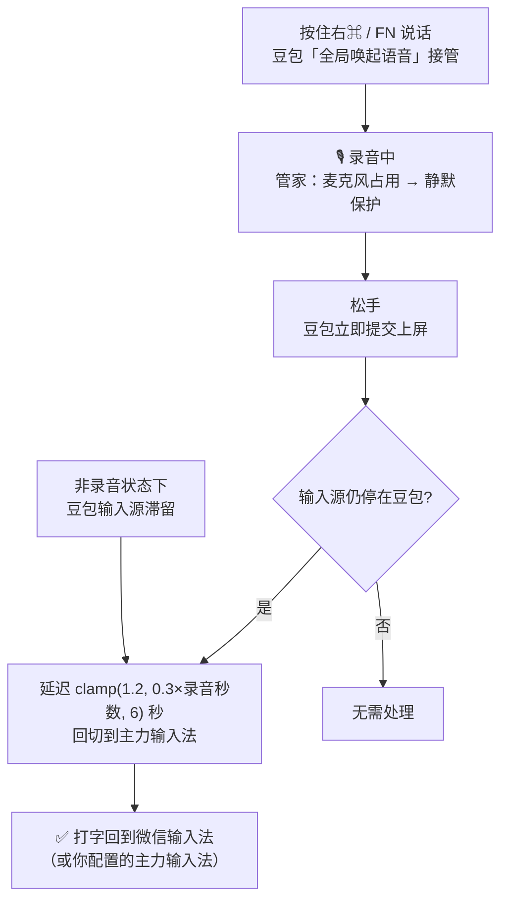

# doubao-ime-janitor

[](https://www.hammerspoon.org/)
[](https://www.hammerspoon.org/)
[](LICENSE)

> **macOS 上的「输入法管家」：语音识别用豆包输入法，打字永远回到你的主力输入法。**
> 按住右⌘（或 FN）说话，松手即上屏；说完约 1~6 秒（按录音时长自适应）自动切回微信输入法（或其他你指定的输入法）。

基于 [Paxxs/Doubao-ime-hammerspoon](https://github.com/Paxxs/Doubao-ime-hammerspoon) 的场景重构，架构与上游完全不同（见 [与上游的差异](#与上游的差异)）。

## 为什么需要它

豆包输入法的语音识别又快又准还免费，但它有个顽疾：**语音结束上屏时，会把系统输入源"劫持"成自己，而且不切回来**——你打字时发现输入法变成了豆包，得手动切回去。反复几次之后，语音输入的便利全被这个来回切换吃掉了。

本项目的答案：豆包输入法自带「全局唤起语音」（跨输入法调起）和「长按模式」（按住说话、松手即上屏），**语音输入的全流程它自己就能完成**。所以脚本不越俎代庖去切输入法、模拟按键，只当好一个管家：

| 状态 | 管家的行为 |
|---|---|
| 有麦克风在录音（任何 App） | **绝不碰输入法** |
| 录音结束、豆包完成上屏 | 延迟 `clamp(1.2, 0.3×录音秒数, 6)` 秒，把输入源送回主力输入法 |
| 非录音状态下豆包滞留（劫持残留等） | 同样送回 |



## 安装

**方式一：一键脚本（推荐）**

```bash
curl -fsSL https://raw.githubusercontent.com/zhangswings/doubao-ime-janitor/main/install.sh | bash
```

> 先 [审阅脚本内容](install.sh) 再执行是好习惯；也可以克隆后本地运行 `./install.sh`。

**方式二：手动安装**

```bash
git clone https://github.com/zhangswings/doubao-ime-janitor.git
cd doubao-ime-janitor
./install.sh            # 或手动: cp init.lua ~/.hammerspoon/init.lua
open -a Hammerspoon     # 首次启动按提示授予「辅助功能」权限
```

**豆包输入法侧的设置**（打开豆包输入法设置面板）：

1. 「语音输入模式 → **长按模式**」绑定按键（推荐右⌘）——按住说话、松手即上屏
2. 「**全局唤起语音**」开启——跨输入法直接调起语音
3. 建议**解绑「免按模式」**——单击容易误触发，且"任意键结束"会打坏预编辑文字

## 配置

所有个性化设置都放在 `~/.hammerspoon/janitor-config.lua`（首次 `./install.sh` 时会自动从示例生成），**不需要改主脚本**。键名支持中文（也兼容英文），只写想覆盖的字段：

```lua
-- ~/.hammerspoon/janitor-config.lua
return {
    -- 换成你自己的输入法源 ID（查法见 FAQ）
    ["语音输入法"] = "com.bytedance.inputmethod.doubaoime.pinyin",   -- 豆包输入法
    ["打字输入法"] = "com.tencent.inputmethod.wetype.pinyin",        -- 微信输入法

    -- 回切节奏：实际延迟 = clamp(回切最短秒, 回切系数 × 录音秒数, 回切最长秒)
    ["回切最短秒"] = 1.2,     -- 短语音基准
    ["回切系数"]   = 0.3,     -- 长语音放大系数（给智能润色留时间）
    ["回切最长秒"] = 6.0,     -- 上限

    ["轮询间隔秒"] = 0.25,    -- 麦克风轮询间隔（秒）
    ["菜单栏图标"] = true,    -- 菜单栏图标与快捷菜单
    ["启动提示"]   = true,    -- 启动时屏幕提示
    ["开机自启"]   = true,    -- 开机自启
}
```

完整字段说明见 [janitor-config.example.lua](janitor-config.example.lua)。改完在 Hammerspoon 菜单选「重载脚本」生效。

**节奏怎么选？**

| 你的偏好 | 建议 |
|---|---|
| 说完马上能打字（润色可以牺牲） | `["回切系数"] = 0.1`、`["回切最长秒"] = 2.0`，或直接关闭豆包的「智能文字整理」 |
| 长文本要完整润色（能等几秒） | 保持默认（长语音最多等 6 秒） |
| 经常一边开会录音一边打字 | 无需担心——任何 App 录音期间管家都不会动输入法 |

## 使用

- **语音**：按住右⌘（或你绑定的按键）说话，松手即上屏；FN、免按模式触发也兼容
- **菜单栏**（麦克风图标）：强制回主力输入法 / 打开豆包输入法设置 / 重载脚本
- **调试命令**：
  ```bash
  tail -f /tmp/hs-doubao-debug.log                        # 实时日志
  open "hammerspoon://doubaoime?cmd=check"                # 查看当前输入源与录音状态
  open "hammerspoon://doubaoime?cmd=home"                 # 强制切回主力输入法
  ```

## FAQ

**语音文字带下划线悬着不消失？**
那是豆包把文字放在预编辑态等「智能文字整理」润色。v5.2 起回切延迟已按录音时长自适应；如果偶尔还遇到，**鼠标点一下输入框**就会强制提交。想彻底杜绝就关闭豆包的「智能文字整理」——所有语音松手即原样提交。

**录音到一半输入法被抢走了？**
确认运行的是 v5 以上版本（麦克风占用检测）。同时检查是否有其他输入法管理工具（如 im-select 类自动切换器）在打架。

**怎么查某个输入法的源 ID？**
切到那个输入法，运行 `defaults read com.apple.HIToolbox AppleSelectedInputSources`，其中 `"Input Mode"` 的值就是源 ID；也可以看调试日志里的 `currentSourceID`。

**会监听我的语音内容吗？**
不会。脚本只查询"麦克风是否被占用"这一个系统属性（`kAudioDevicePropertyDeviceIsRunningSomewhere`），不接触任何音频数据，也没有网络请求。

## 与上游的差异

| | 上游 Doubao-ime-hammerspoon | 本项目 |
|---|---|---|
| 语音触发 | 脚本模拟双击 Option | 豆包原生手势（右⌘长按 / FN / 免按） |
| 输入法切换 | 脚本切到豆包再"恢复上一次" | 完全不切，只做劫持后的回切 |
| 录音判断 | 右 Command 按键事件（实测易漏） | 麦克风占用轮询（对所有触发方式生效） |
| 恢复目标 | "上一次输入法"（记录会被劫持污染） | 强制回指定的主力输入法 |
| 长语音 | — | 自适应延迟，避免打断「智能文字整理」 |
| 个性化 | 改 init.lua | 独立配置文件 janitor-config.lua |

上游「恢复上一次输入法」的设计实测有缺陷：语音结束时豆包劫持输入源，会把"上一次"的记录污染成豆包自己，导致永远切不回。

## 踩坑记录（改代码前必读）

1. **不要自己切 IME、不要模拟按键**——会和豆包原生手势打架（v1~v3 的教训）
2. **右 Command 的 flagsChanged 事件可能收不到**（被豆包全局监听拦截），录音判断只能靠麦克风占用
3. **语音文字以预编辑态（下划线）插入，切换输入法会丢弃未提交文字**——只能在松手提交后再切
4. 长语音的润色需要数秒，回切延迟必须按录音时长自适应

## 关于自动更新

本项目**不包含、也不需要**任何自动更新机制（上游亦无，`install.sh` 只做安装）。Hammerspoon 自身的更新检查建议保持关闭（`SUEnableAutomaticChecks = 0`）。豆包输入法 App 内置的更新器属于字节跳动的 App，与本项目无关。

## License

[MIT](LICENSE)。灵感来自 [Paxxs/Doubao-ime-hammerspoon](https://github.com/Paxxs/Doubao-ime-hammerspoon)（上游未声明 License），架构与实现为本项目重写。
